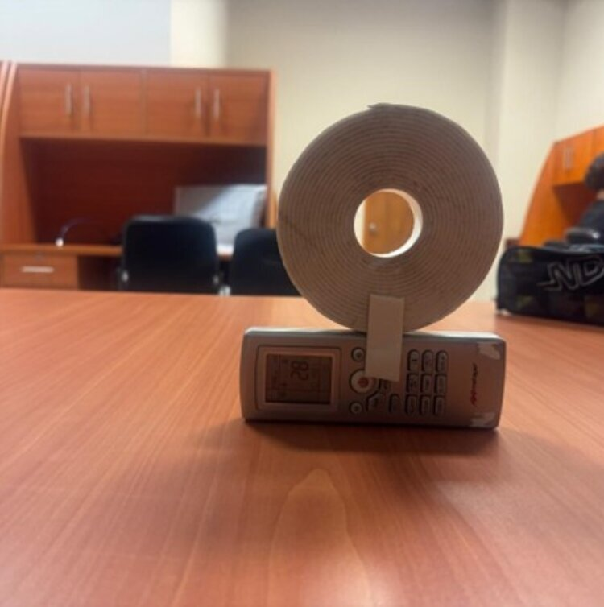
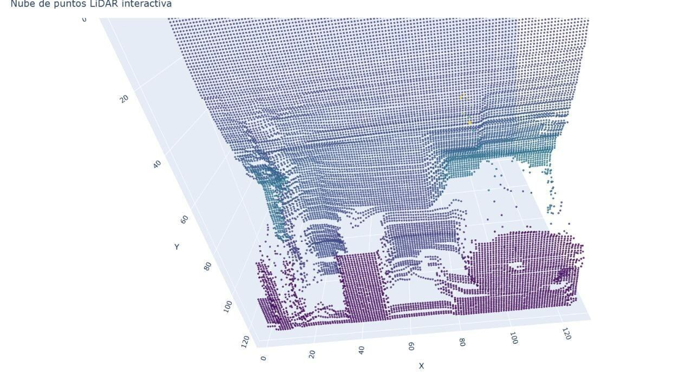
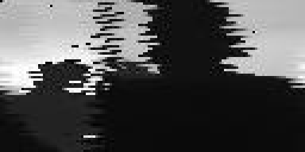
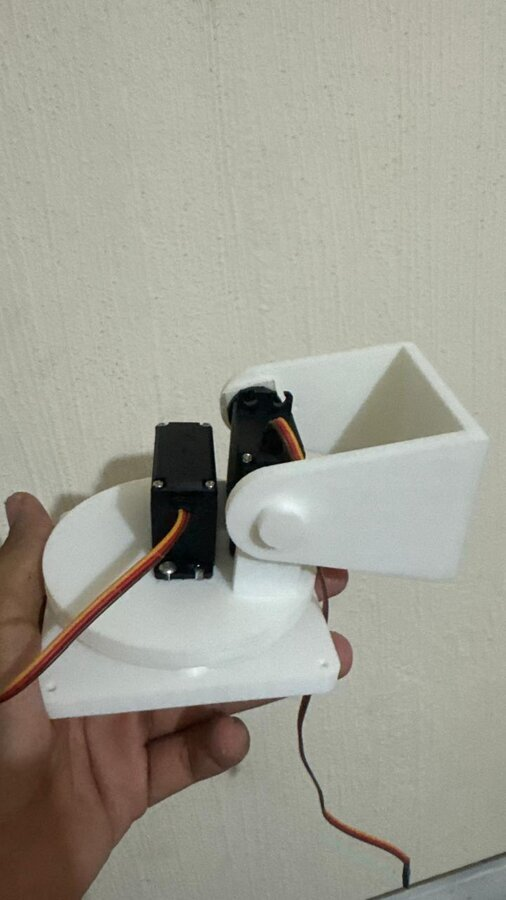
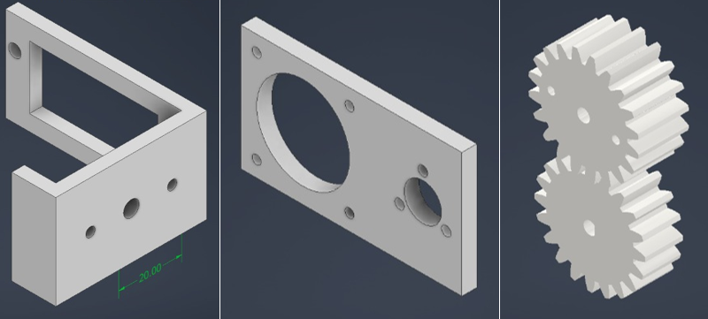
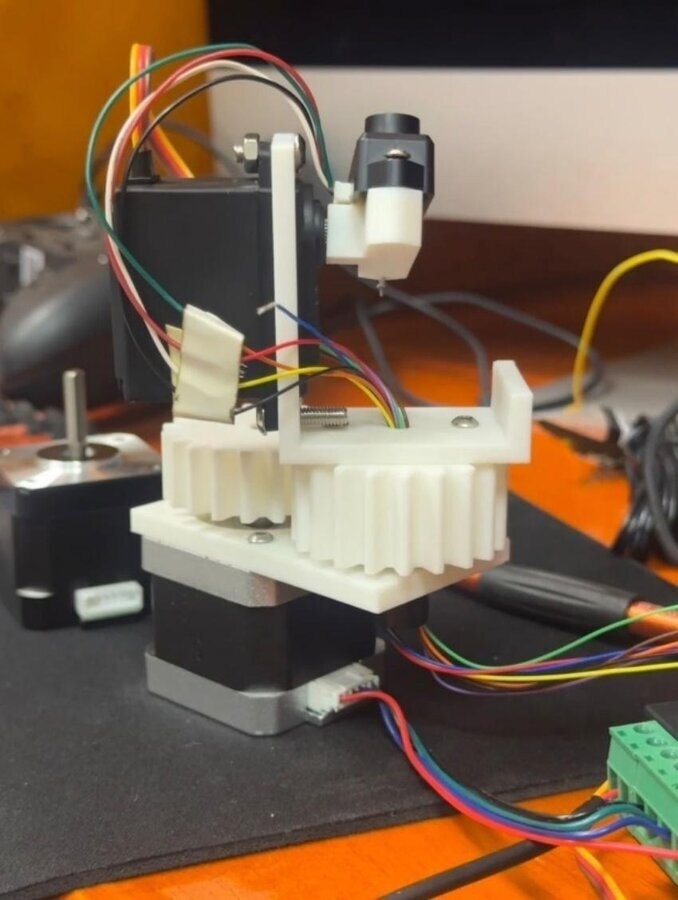
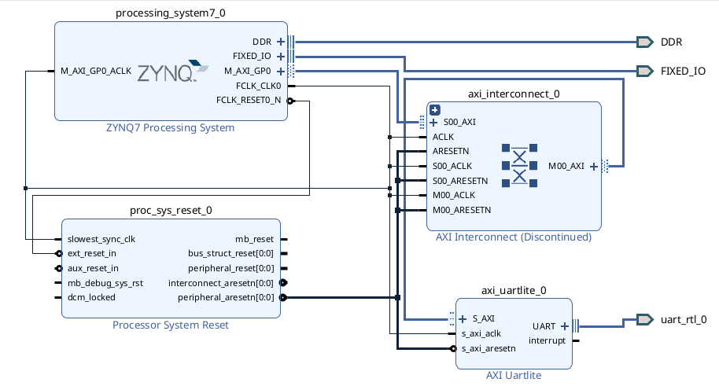
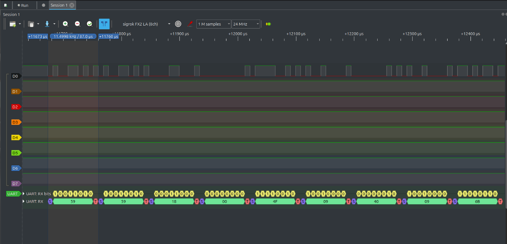

# Escáner LiDAR de dos ejes

Un sensor de distancia LiDAR de un solo punto, montado sobre dos ejes, que barre una escena punto por punto y la reconstruye como imagen de profundidad y como nube de puntos en 3D.

Fue mi proyecto de residencia profesional. Tiene dos etapas: el escáner funcionando con un ESP32, y su migración a una FPGA PYNQ-Z1.

| Objeto | Imagen de profundidad | Nube de puntos |
|---|---|---|
|  |  |  |

El mismo barrido con personas delante del sensor, a 128 × 64 puntos:

| Una persona | Dos personas |
|---|---|
|  |  |

## Cómo funciona

1. Un servo inclina el sensor (eje Y) y un motor a pasos lo gira (eje X).
2. En cada posición el sensor TFmini-S mide una distancia.
3. El ESP32 manda cada fila de distancias por el puerto serie.
4. Un programa de Python arma la matriz, la guarda en CSV y la dibuja en escala de grises: más claro es más cerca.
5. Otro programa convierte esa matriz en una nube de puntos interactiva.

El barrido va en zigzag: al terminar cada fila el motor a pasos cambia de sentido, para no tener que volver al inicio.

## Estado

- **Escáner con ESP32:** funciona. De ahí salen las imágenes de arriba.
- **FPGA:** el diseño de bloques con el puerto serie se sintetiza y se carga en la placa, y el periférico se lee desde Python. La lectura del sensor no quedó resuelta: los datos llegaban desincronizados, aunque con el osciloscopio y el analizador lógico se comprobó que la trama del sensor era correcta.
- **Lector del sensor en VHDL:** escrito después de la residencia. Pasa su simulación; falta probarlo en la placa.

## Mecánica

Hubo dos prototipos, los dos impresos en 3D:

| Primer prototipo | Diseño del segundo | Segundo prototipo |
|---|---|---|
|  |  |  |

- **Primero:** dos servomotores, uno por eje. Fácil de armar, pero con poca precisión para un barrido fino.
- **Segundo:** un servo para la inclinación y un motor a pasos con engranes para el giro. El motor a pasos da movimientos pequeños y repetibles, que es lo que pide el eje con más puntos.

## El sensor

El TFmini-S mide por tiempo de vuelo y entrega la distancia por UART.

| Parámetro | Valor |
|---|---|
| Alcance | 0.1 m a 12 m |
| Precisión | ±6 cm hasta 6 m; ±1 % de 6 m a 12 m |
| Resolución | 1 cm |
| Campo de visión | 2° |
| Frecuencia de muestreo | 1 a 1000 Hz |
| Alimentación | 5 V, 140 mA en promedio |
| Nivel lógico | 3.3 V |
| Puerto serie | 115200 baudios, 8 bits, sin paridad, 1 bit de parada |

Cada medición llega en una trama de 9 bytes:

| Byte | Contenido |
|---|---|
| 0 y 1 | `0x59 0x59`, cabecera |
| 2 y 3 | Distancia en cm, parte baja y parte alta |
| 4 y 5 | Intensidad de la señal, parte baja y parte alta |
| 6 y 7 | Temperatura, parte baja y parte alta |
| 8 | Suma de los ocho bytes anteriores, quedándose con los 8 bits bajos |

Por ejemplo, `59 59 1E 00 94 00 1F 00 83` es una distancia de `0x001E` = 30 cm con intensidad `0x0094` = 148.

El sensor avisa de una medición no válida con una intensidad menor de 100 o con una distancia de 65532 en adelante (poca señal, saturación o demasiada luz ambiental). El escáner guarda como 0 los puntos con intensidad menor de 100 o distancia fuera de rango.

## Etapa 1: ESP32

Los programas están en `esp32/` y se cargan con el IDE de Arduino.

| Programa | Qué hace |
|---|---|
| `lectura_cruda` | Escribe cada trama del sensor tal cual llega, en hexadecimal |
| `lectura_distancia` | Comprueba la suma de la trama y escribe distancia e intensidad |
| `escaner` | Barre los dos ejes y manda la matriz de distancias |

Las dos lecturas se probaron en un ESP32-S3 Zero:

| TFmini-S | ESP32-S3 Zero |
|---|---|
| TX | GPIO6 (RX) |
| RX | GPIO7 (TX) |
| 5 V | 5 V |
| GND | GND |

El escáner usa un ESP32 con estas conexiones:

| Señal | Pin |
|---|---|
| TX del TFmini-S | GPIO16 (RX) |
| RX del TFmini-S | GPIO17 (TX) |
| Servo del eje Y | GPIO19 |
| Paso del motor del eje X | GPIO23 |
| Sentido del motor del eje X | GPIO22 |

Necesita las bibliotecas `ESP32Servo` y `TFMPlus`.

### Recibir y dibujar el escaneo

```sh
pip install pyserial numpy matplotlib plotly
python python/recibir_escaneo.py
python python/nube_de_puntos.py
```

`recibir_escaneo.py` manda `START`, que es lo que pone en marcha el barrido, y al terminar deja `lidar_<fecha>.csv` y `lidar_<fecha>.png`. El puerto serie se elige en la variable `PUERTO`.

`nube_de_puntos.py` lee `lidar_output.csv`: hay que copiar o renombrar el CSV del escaneo que se quiera ver.

El protocolo entre el ESP32 y la computadora es este: cada fila empieza con el byte `0xAA`, sigue con 128 distancias en hexadecimal de cuatro dígitos separadas por comas y acaba con `0xFF`. Tras la última fila se manda `END`.

## Etapa 2: FPGA

La placa es una PYNQ-Z1 (Zynq XC7Z020), con Vivado 2024.2.

### Puerto serie en la lógica programable



El diseño de bloques une el procesador Zynq con un periférico AXI Uartlite, configurado a 115200 baudios, 8 bits y sin paridad, igual que el sensor. Sus dos señales salen por el conector PMOD B (`fpga/restricciones/uart_pmodb.xdc`).

Para usarlo:

1. Generar el bitstream en Vivado y exportar el hardware.
2. Copiar a la placa el `.bit` y el `.hwh`:
   ```sh
   scp UART_wrapper.bit UART_wrapper.hwh xilinx@<ip-de-la-placa>:/home/xilinx/jupyter_notebooks/
   ```
3. En un cuaderno de Jupyter de la placa, ejecutar `fpga/uart_pynq.py`, que carga el bitstream y lee el periférico por sus registros.

### El problema de sincronización



La FPGA recibía bytes que no correspondían a la trama. Midiendo la línea con osciloscopio y analizador lógico se vio que el sensor transmitía bien, con la cabecera `59 59` y la velocidad esperada, así que el fallo está del lado de la FPGA. No llegué a encontrar la causa.

### Lector del sensor en VHDL

`fpga/lidar/` tiene el otro camino: leer el sensor con lógica propia, sin el procesador.

| Archivo | Qué es |
|---|---|
| `lidar.vhd` | El módulo principal de la residencia. Conecta el lector con un analizador lógico integrado (ILA) para ver la distancia desde Vivado |
| `tfmini_interface.vhd` | El lector: recibe los bytes de la línea serie, busca la cabecera `59 59`, comprueba la suma y entrega la distancia |
| `tb_tfmini_interface.vhd` | Banco de pruebas del lector |

Durante la residencia el lector quedó solo con la plantilla vacía. Lo escribí después, a partir de las entradas y salidas que ya pedía `lidar.vhd`. Está simulado y no se ha probado en la placa.

El banco de pruebas le manda tramas como lo haría el sensor y comprueba que entrega la distancia correcta, que descarta una trama con la suma mal, que ignora bytes sueltos antes de la cabecera y que se recupera si empieza a escuchar a media trama. Se corre con [GHDL](https://github.com/ghdl/ghdl):

```sh
cd fpga/lidar
ghdl -a --std=08 tfmini_interface.vhd tb_tfmini_interface.vhd
ghdl -e --std=08 tb_tfmini_interface
ghdl -r --std=08 tb_tfmini_interface
```

Para sintetizar `lidar.vhd` hay que generar antes en Vivado el ILA (`ila_0`), con una sonda de 16 bits y otra de 1 bit. El lector supone un reloj de 50 MHz; con otro reloj se cambia su parámetro `CLK_HZ`.

### Ejercicios de VHDL

Antes del diseño de bloques hice una serie de ejercicios para aprender VHDL y el flujo de Vivado, probados en la placa con sus botones y LEDs. Están en `fpga/vhdl/`:

| Carpeta | Módulos |
|---|---|
| `compuertas/` | AND, OR, NOT, NAND, NOR, XOR y XNOR |
| `combinacional/` | Semisumador, sumador completo, comparador de 1 bit, decodificador de 2 a 4, binario a Gray, decodificador de 7 segmentos y ALU de 8 bits |
| `secuencial/` | Flip-flops D, T, JK y SR; contadores binario y BCD con reinicio síncrono y asíncrono; contador Gray |
| `perifericos/` | Controlador de un motor a pasos |

Los puertos de casi todos llevan el nombre del botón o del LED que usan (`btn0`, `led0`…), que son los del archivo de pines de la placa, `fpga/restricciones/pynq-z1.xdc`. Para probar uno basta con crear un proyecto para la PYNQ-Z1, añadir el `.vhd` y ese archivo de restricciones.

## Licencia

El código es mío y se publica con la licencia [MIT](LICENSE). El archivo `fpga/restricciones/pynq-z1.xdc` es de Xilinx y conserva su licencia BSD de 3 cláusulas.
